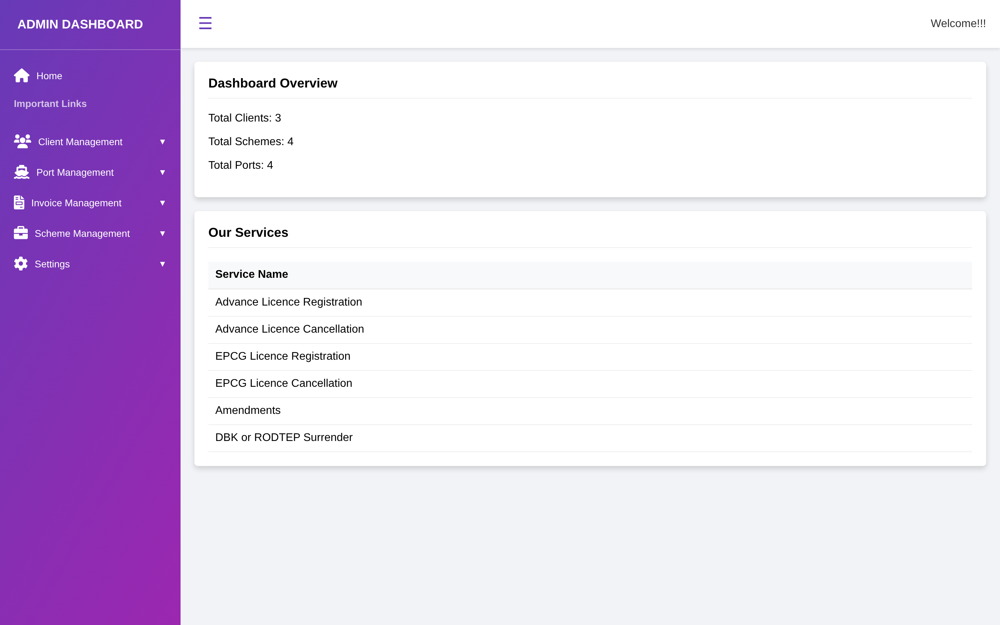
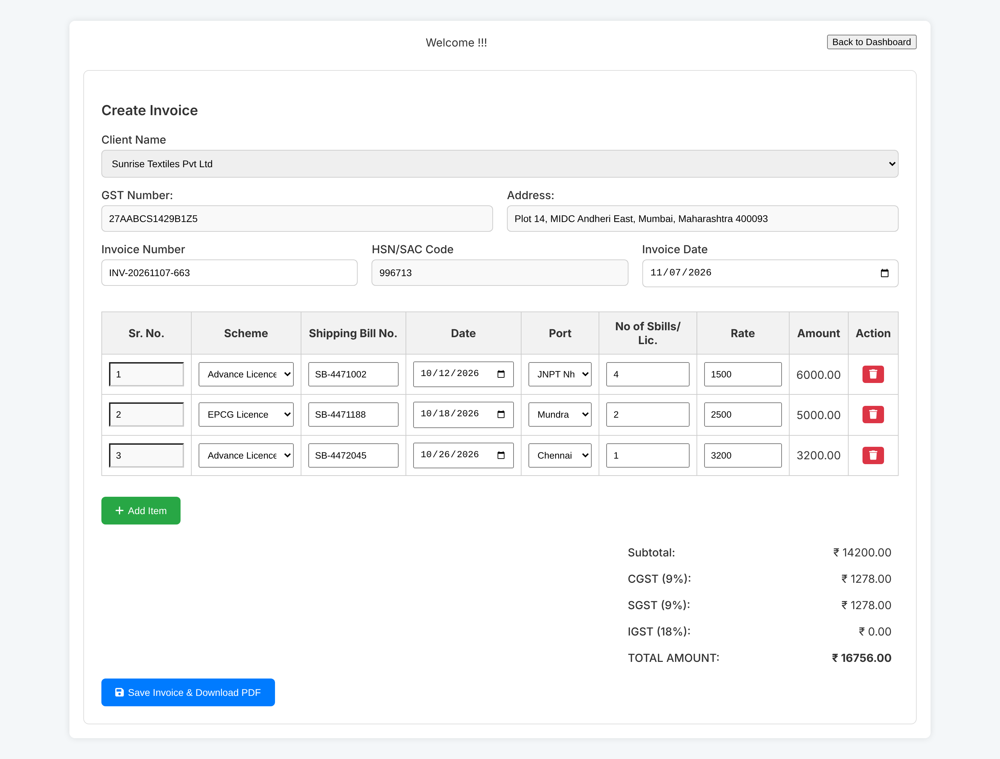
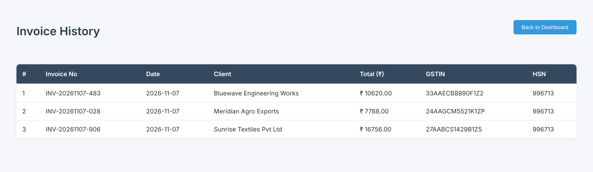

# InvoiceManagement_

**Kwick Exim Services – Invoice Management System**

This project streamlines invoice creation and secure data storage for businesses involved in import-export operations. Built to support consultancy services in license verification and trade compliance, it enhances operational efficiency and transparency.

## 📊 Badges


## 🔧 Features

- Invoice creation and editing  
- Invoice History Tracking  
- Multi-database connectivity  
- Secure data handling  
- Responsive web design (HTML, CSS, JS)  
- Integration-ready for backend services  
- Client, Port, Invoice, Scheme Management  

## 🌐 Live Preview

Currently hosted on `localhost:3000`  
- Dashboard: `http://localhost:3000`  
- API Test: `http://localhost:3000/api/test-connection`

## 🌍 Use Case

Designed for **Kwick Exim Services**, a consultancy specializing in Advance Licence, EPCG Licence, and international trade documentation.  
This system supports over **100+ businesses** and **10,000+ licenses processed**.

## 📁 Tech Stack

- HTML, CSS, JavaScript  
- Optional backend: Node.js, Express  
- Sequelize ORM  
- Git for version control  

## 📄 License

This project is licensed under the MIT License.  
Developed and maintained by Shravani  © 2025.


## 🚀 How to Run
1. Clone the repo:  
   `git clone https://github.com/shavu05/Invoice_Management.git`
2. Open `index.html` in your browser
3. Customize as needed for your consultancy or client

## 📄 License
This project is developed and maintained by Shravani
All rights reserved © 2025.


## 🚀 Getting Started
```bash
npm install
node server.js

---

## 🖼️ Project Screenshots

### Homepage


### Login


### Dashboard


### Create Invoice


### Invoice History

